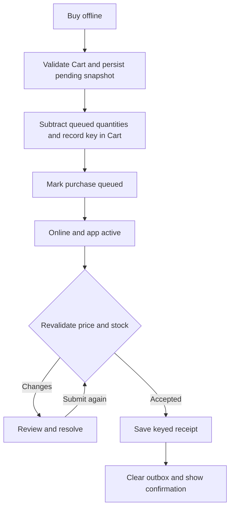
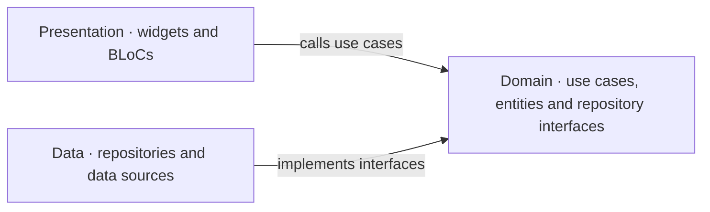

# GrocerMate

GrocerMate is a Flutter grocery shopping app that lets a shopper browse a catalog, keep a persistent Cart and Saved list, and place an order even after losing connectivity. Checkout compares the shopper’s expected prices and quantities with a bundled mock inventory. If either has changed, the shopper sees the differences and the revised total before submitting again.

## Demo Video

[Watch the GrocerMate demo on Google Drive](https://drive.google.com/file/d/1KXRy7vk8bNl6MWH7h3_bu6gngFJNSXT3/view?usp=sharing)

## Features overview

- **Catalog and discovery.** Browse paginated products with deal and stock badges, search by name, filter by category or brand, and open product details.
- **Cart and checkout.** Adjust quantities, move individual or selected items between Cart and Saved, and review price or stock changes before placing an order.
- **Offline use.** Browse cached products and details, manage both shopping lists, and see when connectivity returns.
- **Bonus — offline outbox.** Queue a purchase offline. On reconnection, the app revalidates the snapshot and either confirms the order or opens it for review.

## Run locally

Use **Flutter 3.50.1 stable with Dart 3.14.0**, the toolchain used for validation. The project declares Dart `^3.14.0`, and the locked dependencies require Flutter `>=3.47.0`. Android was smoke-tested on a physical Samsung Galaxy A54 (SM-A546E). An iOS runner is included and its runtime behavior is unverified.

Install the Flutter SDK and configure an Android device or emulator, or an iOS simulator with Xcode on macOS. From a fresh checkout, run the following commands. The app needs no account, API key, or backend setup.

```sh
git clone https://github.com/mahmoudzaher00/grocer-mate.git
cd grocer-mate
flutter doctor
flutter pub get
flutter devices
flutter run
```

With multiple targets, use `flutter run -d <device-id>`. Start online to populate the offline catalog.

## Try the assessment flows

The fixtures contain **7 categories and 33 products**. Categories, products, and descriptions with image URLs live in separate JSON files. Checkout uses catalog values unless `purchase.json` overrides a product. `flags.json` supplies the cart pricing rules and price-revalidation setting. [Mock fixtures](assets/jsons/)

**Checkout setup.** Start each purchase example online with an empty Cart and no pending purchase. After a review, remove any unpurchased units left in Cart before starting the next example. Saved items can stay in place.

| Scenario | Steps and expected result |
| --- | --- |
| Search, filter, and retry a page | Open **Fruits**, search for `apple`, then select **FreshFarm** to narrow the results to Apple Gala. To exercise pagination, reopen Fruits with an empty search and no brand filter. Scroll past the first 10 products. In debug mode the first online request for Fruits page two fails once per app run. Tap **Retry** in the footer to load the remaining four. |
| Cart and Saved for Later | Open a product, add it to Cart, and adjust its quantity. Save one item using its row action, or select several and tap **Save selected**. Restore them from Saved. Both lists survive an app restart. |
| Normal purchase | Add one **Banana (1kg)** and tap **Place order**. The confirmation shows **$2.88** including $0.09 tax and $1.00 delivery. |
| Price change only | Add one **Milk 2% (1L)** from Dairy and tap **Place order**. Accept $1.39 in place of $1.29 and tap **Submit order again**. |
| Out of stock only | Add one **Apple Gala (1kg)** and one **Banana (1kg)** from Fruits. Tap **Place order**, remove the unavailable apples, and resubmit. The banana keeps the order eligible for submission. |
| Reduced stock only | Add **two Sourdough Bread** from Bakery and tap **Place order**. Tap **Reduce to 1** and resubmit. |
| Mixed checkout conflicts | Add one **Milk 2% (1L)** from Dairy, one **Apple Gala (1kg)** from Fruits, and **two Sourdough Bread** from Bakery. Tap **Place order**. Accept the milk increase from $1.29 to $1.39, remove the unavailable apples, and reduce the bread from two to one. With just the milk and bread remaining, **Submit order again** confirms **$5.39**. |
| Offline purchase and reconnection | Open **Milk 2% (1L)** in Dairy and add one to Cart. Disable Wi-Fi and mobile data and wait for the offline banner. Browse cached products, move milk to Saved and back, then tap **Buy offline**. The queued purchase appears in Cart. Restore connectivity with the app in the foreground. Checkout opens automatically for the milk price change. Accept it and resubmit. Items added to Cart after queuing stay there. |

## Catalog and offline browsing

Product cards show the selling price, discount and stock status. Details add an image gallery, brand, rating, description and a stock-aware quantity control. Search matches a case-insensitive substring of the product title and combines it with category and brand. Switching category clears the selected brand and loads the new options.

`ProductsBloc` debounces text changes with a cancellable **400 ms** timer. Starting a refresh increments a query revision. Category, brand and page responses check that revision before updating state, so a slower refresh cannot overwrite a newer one. Near the end of the list, a per-revision in-flight guard admits one page request. Successful pages merge by product ID. A first-page failure offers a full retry. A later failure keeps the loaded products visible and retries the same page. [Products BLoC](lib/features/catalog/presentation/manager/products/bloc.dart)

`ConnectivityBloc` checks internet reachability at startup and listens for changes. Online reads use the asset-backed service and populate the local cache. Loading a product page or its brand options caches the full small product list, so search, filtering and pagination work offline across categories. Details are cached individually when opened. An uncached detail explains how to make it available. Remote images have a separate cache and a fallback. Failed catalog screens retry on reconnection, and a cache-write failure still allows the successful online result to display. [Catalog repository](lib/features/catalog/data/repositories/catalog_repository_impl.dart)

## Cart and checkout consistency

- **Quantity and persistence.** Cart and Saved share one stored record. Moving items merges quantities by product ID. Restoring a saved item fills the available Cart capacity and leaves any excess in Saved. The reader also accepts the older cart-only list format.
- **BLoC event transformers.** Cart, Checkout and Outbox each register one handler for their base event type with an `asyncExpand` event transformer. Events run sequentially within each BLoC, including across event subtypes. A checkout snapshot request joins the Cart event queue, so a quantity tap immediately before checkout is included. The cart repository also serializes operations from different callers and compares persisted IDs and quantities in both lists before saving an edit. A stale write fails and the BLoC retains the previous cart. [Cart BLoC](lib/features/cart/presentation/manager/bloc.dart) · [Cart repository](lib/features/cart/data/repositories/cart_repository_impl.dart)
- **Totals.** The Cart rounds unit prices to integer cents before multiplying by quantity. Subtotal uses selling prices, so discount savings are shown separately. Tax is 5% of subtotal, rounded to the nearest cent. Delivery is $1.00 on a nonempty cart below $25.00 and free at or above that subtotal. Each immutable Cart computes these amounts lazily. [Cart calculations](lib/features/cart/domain/entities/cart.dart)
- **Revalidation.** The checkout sheet submits a snapshot. Price and stock issues can arrive together. Review actions update that snapshot and recalculate its total. Resubmission requires a nonempty order with every issue resolved and runs the checks again. Losing connectivity during review resubmission preserves the resolved review for retry. On ordinary checkout success, Cart subtracts the purchased quantities and preserves unpurchased units and Saved items. [Checkout BLoC](lib/features/checkout/presentation/manager/bloc.dart)

## Bonus — offline purchase outbox

**Buy offline** persists one pending purchase. Its snapshot contains the items, quantities, expected prices, pricing rules, UTC creation time and an idempotency key. The shopper can continue building a new cart while the order is pending. A second checkout is blocked until the first is resolved.



**Write order and recovery.** The cart repository verifies quantities before saving the pending snapshot. It then saves the reduced cart and the detachment key together. At startup, recovery runs before Cart loads. If the app stopped between writes, recovery completes the subtraction or recognizes its key and skips a second subtraction. A failed recovery blocks cart mutations and offers a retry. The preferences wrapper serializes access, attempts to restore a failed write, and checks the restored value before allowing further operations. [Queue use case](lib/features/checkout/domain/use_cases/queue_offline_purchase.dart) · [Recovery use case](lib/features/checkout/domain/use_cases/recover_queued_purchase.dart) · [Preferences](lib/core/storage/app_preferences.dart)

**Review, cancellation and retry.** The coordinator waits for a resumed app and a ready navigator. It opens checkout automatically once per online session. Closing an unresolved review leaves the original snapshot pending. **Review purchase** reopens it manually. Removing every item from a queued review enables explicit discard for that purchase key. A failed discard keeps it pending. After success, a failed outbox clear offers **Retry cleanup**, which retries removal alone. If the app restarts first, the mock can replay its last successful receipt for the same key. [Outbox BLoC](lib/features/checkout/presentation/manager/outbox/bloc.dart)

**Guarantee boundary.** This is a foreground, single-device mock with one pending purchase and one keyed receipt. SharedPreferences acknowledges individual writes and provides no crash-durable, multi-record transaction. The mock uses a fixed order ID and static inventory. A production service would need to enforce idempotency, calculate the authoritative total and commit the order and stock changes transactionally.

## Clean Architecture

Feature dependencies point toward Domain. GetIt supplies the concrete repository when it constructs a use case.



```text
lib/
  core/       App composition, routing, connectivity, preferences, themes, shared widgets
  features/
    catalog/  Categories, product queries and details
    cart/     Cart, Saved, quantities and totals
    checkout/ Purchase review, submission and outbox recovery
    splash/   Launch presentation
assets/jsons/ Catalog, details, pricing and purchase fixtures
```

Catalog, Cart and Checkout each have `presentation/`, `domain/` and `data/` layers. Widgets send events to BLoCs, which invoke use cases through constructor-injected dependencies. Domain repository interfaces define the operations. Data implementations validate and map JSON, read assets or preferences, and return `Either<Failure, T>`. This keeps storage formats and plugin exceptions out of the UI. Domain entities such as `Cart` expose read-only collections and copy operations, so edits produce a new value for state comparison. The queue and recovery use cases coordinate Checkout with Cart through the same detachment operation.

**SOLID in practice.** Single responsibility separates checkout review transitions in `CheckoutBloc` from fixture parsing in the data source. Interface segregation keeps `CheckoutRepository` focused on submission and puts queue persistence behind `CheckoutOutboxRepository`. Dependency inversion lets `SubmitPurchase` depend on the domain contract while the data layer supplies its implementation.

**Patterns and dependency injection.** The Repository pattern gives catalog use cases one API for online fixture reads and offline cache reads. The Outbox pattern persists purchase intent for replay after reconnection. GetIt acts as the service locator at composition time and injects repositories, data sources and use cases through constructors. Cart, Outbox, theme and connectivity have app-wide lifetimes. Factory registrations give catalog routes and checkout sheets their own BLoCs, so leaving a view releases its screen state. These boundaries allow a test to substitute a repository and control exactly when an asynchronous operation finishes. [Dependency registration](lib/core/app/app_di.dart)

**Dependency choices.** `flutter_bloc` and `equatable` handle events, subscriptions and value comparisons. `dartz` represents success or failure, and `get_it` composes implementations. `shared_preferences` fits the small local snapshots, and `internet_connection_checker` supplies reachability. `cached_network_image` reuses downloaded photos, `skeletonizer` renders loading states and `flutter_screenutil` scales layout dimensions. The mock filters its small in-memory catalog before slicing a page. Larger inventories would warrant indexed storage or server-side queries.

## UI and rendering

- **Theme and layout.** Shared color schemes, Nunito text styles and component themes give buttons, fields and sheets a consistent appearance. The app follows system brightness by default and remembers an explicit light or dark choice. ScreenUtil scales spacing in the portrait layout, and Cart/Saved rows are capped at 760 logical pixels. [App theme](lib/core/theme/app_theme.dart)
- **Scrolling and selection.** A `NestedScrollView` lets the Cart header scroll away while the tab bar stays pinned. Separate scroll keys retain each list’s position. Catalog slivers and Cart/Saved builders create rows on demand. Each tab keeps checkbox state by product ID, so selections survive scrolling offscreen. Removed items release their notifiers. [Cart view](lib/features/cart/presentation/view/view.dart) · [Selection handling](lib/features/cart/presentation/view/widgets/item_selection.dart)
- **Scoped rebuilds.** Each checkbox listens to its own `ValueNotifier<bool>` through a `ValueListenableBuilder`. The bulk button listens only for a switch between empty and nonempty selection. On the Galaxy A54, Flutter build traces recorded **zero product-card rebuilds and zero order-summary rebuilds** during the tested Cart and Saved checkbox taps, including a Cart selection with the summary on screen. The cart badge selects the item count, the banner selects offline status, and the product detail action bar selects only the outbox flag that blocks cart edits. [Cart action bar](lib/features/catalog/presentation/view/product_details/widgets/cart_action_bar.dart)
- **Feedback and accessibility.** Catalog skeletons follow the layout of the incoming content. Shared empty and error widgets offer **Clear all** for an unmatched filter or **Retry** for a failed request. The offline banner uses a semantics live region so screen readers can announce connectivity loss. Gallery images identify the product and image position, and the quantity stepper labels its increase and decrease actions. [Offline banner](lib/core/widgets/status_views/offline_banner.dart)
- **Motion and lifecycle.** One controller staggers the splash logo, title and tagline. Leaving the splash screen cancels its navigation timer and disposes the controller. A Hero tag keyed by product ID connects the tapped product image to its detail gallery. [Splash animation](lib/features/splash/presentation/view/widgets/body.dart)

## Validation

| Check | Verified result |
| --- | --- |
| Static analysis | `flutter analyze` completed with **zero issues**. |
| Repository test suite | `flutter test` passed **18 of 18 tests**. The [startup smoke test](test/widget_test.dart) launches the app offline, advances past the splash screen, and verifies the cached Fruits category and the offline banner. |
| Feature regressions | All 17 regression checks run in the repository suite. [Catalog search (3)](test/features/catalog/products_search_test.dart) covers overlapping metadata requests and clearing a pending debounce. [Cart concurrency (6)](test/features/cart/cart_concurrency_test.dart) covers rapid edits and checkout snapshots. [Cart persistence (7)](test/features/cart/cart_repository_test.dart) covers stale writes, quantity checks and interrupted or repeated detachment. [Outbox discard (1)](test/features/checkout/outbox_discard_test.dart) covers dismissal, guarded discard and retry after a storage failure. |
| Diff validation | `git diff --check` passed. |
| Prior physical Android smoke tests | Galaxy A54 checks covered search with filters, page-two retry, single and bulk Cart/Saved moves, checkout review and updated totals. An offline order queued successfully, blocked a second checkout, then confirmed on reconnect while preserving a newly added Cart item. Cart and Saved controls also fit at 320 and 384 logical pixels. |
